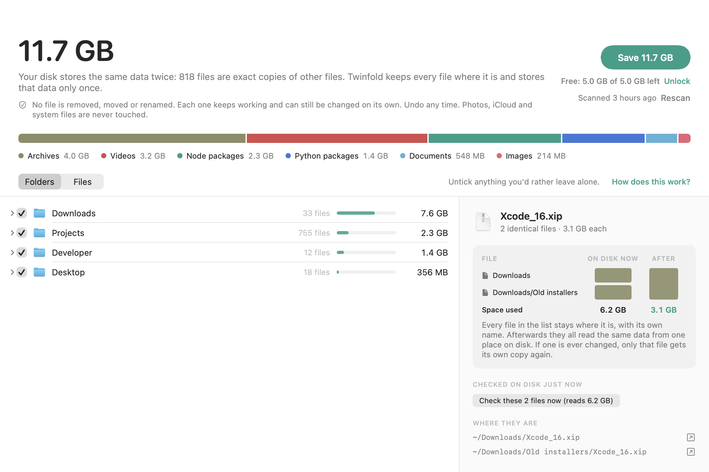

<p align="center">
  
</p>

<h1 align="center">Twinfold</h1>

<p align="center">
  Get disk space back on your Mac without removing any files.
</p>

<p align="center">
  <picture>
    <source media="(prefers-color-scheme: dark)" srcset="docs/images/results-dark.png">
    
  </picture>
</p>

Your Mac is full of identical files: the same `node_modules` in five projects, the same PyTorch in every
virtualenv, the same video saved to Downloads twice. Each copy takes its own space on disk.

Twinfold finds them and turns the copies into **clones**. Every file stays exactly where it is, with its
own name, dates and permissions, but the copies now share one set of blocks on disk. Edit one and only
that one changes; macOS handles it automatically.

On the Mac it was built on, Twinfold found **36 GB** to free, without deleting a single file. It scans a
home folder of 8.7 million files in about a minute, and you see exactly what will change before anything does:
by kind, by folder, and file by file, with anything you'd rather leave alone a click away. Click any file
to see every identical copy, the disk space now and after, and a live check that reads the files and
shows they are byte-for-byte identical and how many times the data is really stored.

<p align="center">
  <picture>
    <source media="(prefers-color-scheme: dark)" srcset="docs/images/files-dark.png">
    
  </picture>
</p>

## Install

**App:** download `Twinfold.zip` from [Releases](https://github.com/Himanshu-Sangshetti/twinfold/releases),
unzip, and drag Twinfold to Applications. The app isn't notarized by Apple yet, so the first time, macOS
will say it can't check it: open it once, then choose **Open Anyway** in System Settings, Privacy & Security.

**Command line:**

```sh
git clone https://github.com/Himanshu-Sangshetti/twinfold && cd twinfold
swift build -c release && cp .build/release/twinfold /usr/local/bin/
```

Requires macOS 14 or later. Works on any APFS volume, the default on every Mac since 2017.

## Pricing

Scanning, the command line tool and the source code are free and unlimited, forever. The app saves up to
5 GB for free; **Twinfold Unlimited** removes the limit for **$12 once** (no subscription, up to 3 Macs).
Buying it is how you support the project. You can also build the app from source and use it as you like:
it's MIT licensed.

## Use

```sh
twinfold scan                 # how much space identical files could share (changes nothing)
twinfold reclaim              # fold them into clones and free the space
twinfold undo                 # give every folded file its own copy again
```

```
$ twinfold scan ~/.cache ~/.venvs

  3.9 GB can be freed, nothing deleted.
  1,137 identical files can share space, in 667 sets · 676,965 files checked in 21s
  (696 MB of identical files already share space)

  255 MB    telecom_4trials.json  ×6
            ~/.cache/tau2-synth/data/results/telecom_4trials.json
            ~/.cache/tau3-bench/data/results/telecom_4trials.json
            …
```

Pass folders to scan only those. `--min-size 1M` skips small files, `--json` prints machine-readable
output, and `--dry-run` shows what `reclaim` would do. See `twinfold help` for everything.

## Is it safe?

Twinfold never deletes a file. For each copy it:

1. clones the twin next to it,
2. compares the clone with the copy **byte for byte** (hashes only pick candidates),
3. copies the copy's own permissions, dates, tags and extended attributes onto the clone,
4. checks the copy hasn't changed in the meantime,
5. swaps the clone into place in one atomic rename.

If anything looks off at any step, that file is left exactly as it was. Every fold is written to a
journal, and `twinfold undo` gives each file back its own private copy.

It stays away from things it shouldn't touch: iCloud Drive, Dropbox and other cloud folders (their files
may not be fully downloaded), Photos and Music libraries, `~/Library` (unless you ask), hard links,
locked files, files owned by other users and system files.

## FAQ

**How is this different from a duplicate finder?** Duplicate finders delete the extra copies, which
breaks whatever expected them to be there. Twinfold keeps every file and still gets the space back.

**What happens when I edit a folded file?** Only that file changes. APFS writes the changed blocks
somewhere new, so the twins are never affected.

**Does Time Machine see the difference?** Time Machine backs files up by content, not by block, so your
backups stay complete. Folded files may be backed up once more because they look changed.

**Does deleting a file still free its space?** Only once every twin is gone. After sharing, deleting one copy
frees less than Finder shows, because the others still use that data.

**Why did the space come back after a while?** If you edit folded files, the edited parts take new
space. Run Twinfold again any time.

**Similar tools:** [Hyperspace](https://hypercritical.co/hyperspace/) is a polished paid app that does
the same thing. [fclones](https://github.com/pkolaczk/fclones) can do it from the command line. Twinfold
is open source, so anyone can read exactly what it does, and every change can be undone.

## Contributing

Bug reports and pull requests are welcome. See [CONTRIBUTING.md](CONTRIBUTING.md). For security
issues, see [SECURITY.md](SECURITY.md).

## License

[MIT](LICENSE)
